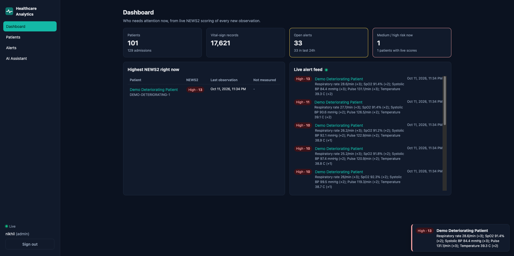
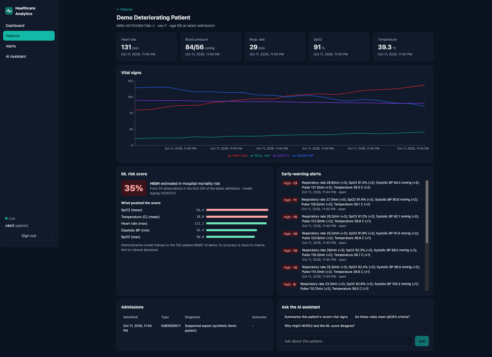
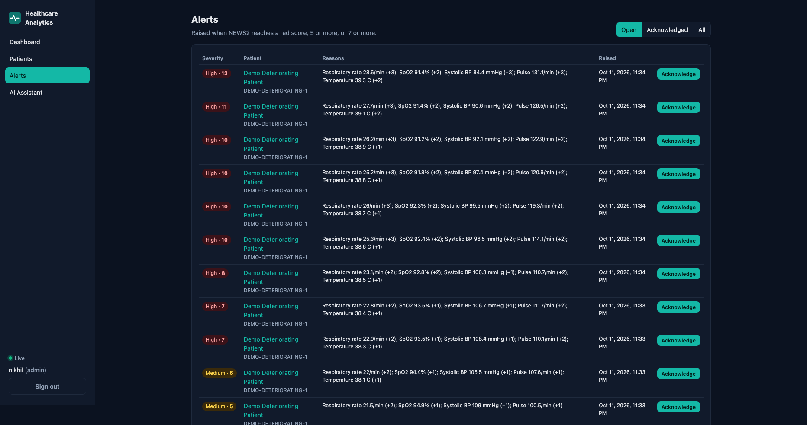
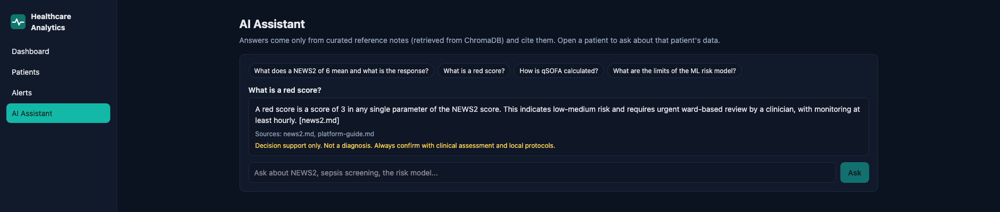
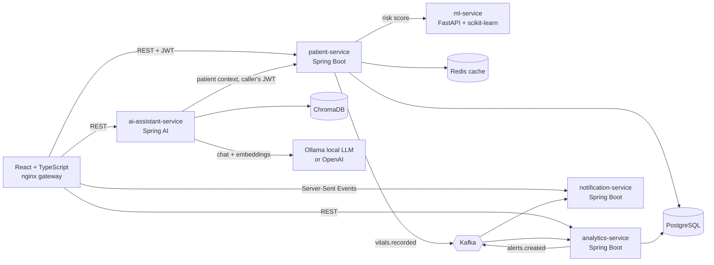

# Healthcare Analytics Platform

An event-driven clinical analytics platform. Every new vital sign is streamed through Kafka, scored in real time with the **NEWS2** early-warning score, and turned into alerts that reach the clinician's browser within a second. A Python ML service estimates in-hospital mortality risk with an explanation of each factor. A **Spring AI** assistant answers questions using retrieval-augmented generation (RAG) over curated clinical reference notes and the selected patient's own data.

Built with Java 21, Spring Boot 4, Kafka, PostgreSQL, Redis, Python/FastAPI/scikit-learn, React 18 + TypeScript, Spring AI + Ollama (local LLM) + ChromaDB, Docker, Kubernetes and AWS EKS. **Runs 100% free on a laptop**: the AI uses a local open model by default, with OpenAI as an optional switch. Data: the open **MIMIC-III Clinical Database Demo** (100 de-identified ICU patients).

> Demonstration project. Not a medical device and not for clinical decisions.

## Screenshots

**Live dashboard**: every new vital sign is scored with NEWS2 within a second; alerts stream to the browser.



**Patient view**: vital-sign trends, explainable ML risk score, early-warning alerts and admissions (synthetic demo patient).



| Alerts (acknowledge workflow) | AI assistant (local LLM, cited sources) |
|---|---|
|  |  |

## Architecture



| Service | Responsibility | Tech |
|---|---|---|
| `backend/patient-service` | Patients, admissions, vital signs; login (JWT, roles); publishes vital-sign events; ML risk endpoint with Redis cache | Spring Boot 4, JPA, Spring Security, Kafka, Redis |
| `backend/analytics-service` | Consumes vital-sign events, computes NEWS2, raises idempotent alerts, dashboard summary | Spring Boot 4, Kafka, JPA |
| `backend/notification-service` | Pushes alerts to browsers in real time | Spring MVC Server-Sent Events, Kafka |
| `backend/ai-assistant-service` | RAG assistant: retrieves reference notes from ChromaDB, adds patient context, answers with citations | Spring AI 2, Ollama (llama3.2 + nomic-embed-text) or OpenAI, ChromaDB |
| `ml-service` | Risk model training, serving and explanation; MIMIC ingest and live-stream simulator | FastAPI, scikit-learn, pandas |
| `frontend` | Dashboard, patients, vitals charts, risk explanation, alerts, assistant chat | React 18, TypeScript, Vite, Recharts |
| `infra` | Docker Compose, Kubernetes (kustomize), AWS EKS (eksctl) | |

## Design decisions

- **Event-driven, not polling.** patient-service only stores the observation and publishes an event keyed by patient id (so one patient's events stay in order). Scoring and notification scale independently.
- **Idempotent consumers.** Kafka delivers at least once, so analytics-service stores the event id with a unique constraint and ignores duplicates. Out-of-order events never overwrite a newer score.
- **Failure isolation.** If Kafka is down, saving a vital sign still succeeds (the publish error is logged). If the ML service is down, the risk endpoint returns `503` with a clear message instead of a stack trace.
- **One feature pipeline.** Training and serving call the same Python feature code, so there is no training/serving skew.
- **Explainable model.** Logistic regression, so each factor shown in the UI is the exact contribution (coefficient x standardised value) to the score.
- **Provider-agnostic AI.** The RAG code depends on Spring AI's `ChatClient` and `VectorStore` interfaces, so switching between a free local model (Ollama) and OpenAI is one setting, not a code change.
- **Least privilege for the AI.** The assistant fetches patient data with the *caller's own* token, so it can never see more than the user can. Patient names are not sent to the LLM. The prompt requires answers only from the retrieved context, with citations.
- **Security.** Stateless JWT shared across services (HS256, secret from the environment, minimum 256 bits), role-based delete (ADMIN only), problem+json errors, non-root containers, secrets never in the repo.

## Clinical logic

**NEWS2** (Royal College of Physicians, 2017) from respiration rate, SpO2 (scale 1), systolic BP, pulse and temperature. Consciousness level and supplemental oxygen are not captured, so this is a *partial* NEWS2, and the UI lists which parameters were missing. Alerts are raised for a red score (any single parameter = 3), an aggregate of 5-6 (medium) and 7 or more (high). Every band boundary is unit-tested.

**ML risk model**: in-hospital mortality from the first 24 hours of charted vitals plus age and sex.

| Model (10 x stratified 5-fold CV) | ROC AUC |
|---|---|
| Logistic regression (deployed, interpretable) | about 0.51 |
| Gradient boosting (comparison) | about 0.60 |

The honest result: with 125 admissions and vital signs alone, both models are close to chance. The deliverable is the end-to-end pipeline (extraction, training, evaluation, serving, explanation, monitoring hooks), which can be retrained unchanged on a larger cohort such as the full MIMIC-III (credentialed access). Exact metrics are written to `models/model_card.json` and served at `/model/info`.

## Run it locally (Docker Compose)

Prerequisites: Docker Desktop, and the MIMIC-III demo CSV files in a local folder (download from [PhysioNet](https://physionet.org/content/mimiciii-demo/1.4/)). The data is mounted read-only and is never copied into the repository.

```bash
cp .env.example .env        # fill in JWT_SECRET (openssl rand -base64 48), passwords, MIMIC_DATA_DIR
scripts/demo.sh             # build, start, train the model, load the 100 demo patients
scripts/simulate.sh         # stream live vitals -> watch alerts appear at http://localhost:3000
scripts/simulate.sh deteriorating   # one synthetic patient who becomes septic
```

**AI assistant (free):** install [Ollama](https://ollama.com), then pull the two models once:

```bash
ollama pull llama3.2:3b        # chat model (~2 GB)
ollama pull nomic-embed-text   # embedding model (~270 MB)
```

The assistant container talks to Ollama on your machine. To use OpenAI instead, set `AI_PROVIDER=openai` and `OPENAI_API_KEY` in `.env`. Each provider gets its own Chroma collection because their embeddings have different sizes.

| URL | What |
|---|---|
| http://localhost:3000 | Web app (login: `nikhil` / your `APP_ADMIN_PASSWORD`) |
| http://localhost:8000/docs | ML service OpenAPI docs |
| http://localhost:8080/actuator/health | patient-service health |

## Run on Kubernetes

Local (free, uses [kind](https://kind.sigs.k8s.io/)):

```bash
scripts/k8s-local.sh
kubectl -n hap port-forward svc/frontend 3000:80
```

AWS EKS (costs money, about $5-6 per day; tear down when done):

```bash
scripts/eks-deploy.sh       # eksctl cluster, ECR images (linux/amd64), kustomize EKS overlay, NLB
scripts/eks-teardown.sh     # deletes the cluster, load balancer, volumes and ECR repositories
```

Manifests: `infra/k8s/base` (Deployments, StatefulSets with persistent volumes, probes on Spring Boot liveness/readiness groups, resource limits, HPA) with `overlays/local` and `overlays/eks`.

## Tests and CI

| Part | Tests |
|---|---|
| patient-service | Full-context integration tests through the real security chain: login, roles, validation, CRUD, vitals, 24-hour risk window, ML outage (H2 in PostgreSQL mode) |
| analytics-service | Every NEWS2 band boundary; alert flow, duplicates, out-of-order events, JWT-protected API |
| notification-service | SSE stream auth, history buffer |
| ai-assistant-service | RAG prompt assembly, source citations, patient context, markdown chunking of the knowledge base |
| ml-service | Feature engineering, MIMIC extraction (unit conversion, error rows, 24 h window, shifted ages), training, API - on synthetic data only |
| frontend | Login flow, risk card, formatting (Vitest + Testing Library) |

GitHub Actions (`.github/workflows/ci.yml`) builds and tests all four Java services, the Python service and the frontend, validates the Kubernetes manifests, and builds every Docker image.

## Data and privacy

- MIMIC-III demo data is used under the Open Data Commons Open Database License; dates are shifted and ages above 89 are masked by the dataset itself.
- No data files, trained models or secrets are committed (`.gitignore` blocks `data/`, `*.csv` and model files).

## Project layout

```
backend/            four Spring Boot services
ml-service/         FastAPI app, training, MIMIC ingest + stream simulator, tests
frontend/           React + TypeScript app and nginx gateway config
infra/              postgres init, Kubernetes (kustomize), EKS (eksctl)
scripts/            demo, simulate, k8s-local, eks-deploy, eks-teardown
docker-compose.yml  whole platform on one machine
```
